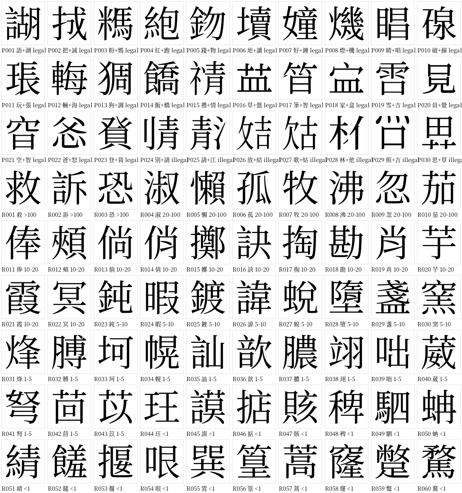

# Pilot draft set v1 (90 items)

A first draft of the test items: 60 real characters and 30 pseudo-characters, rendered as 400 x 400 px PNG images with a transparent background in Source Han Serif TC (思源宋體 TC). It is meant for review by the team and for pilot testing. It is not the final test.

Every item has `review_status = pending`. No item has been checked by a person yet (see [Review checklist](#review-checklist)).

## Files

| File | Content |
| --- | --- |
| `items.csv` | The item list in the pseudo-character maker's format, plus the columns below. It can be imported with `python -m app.cli import-bank`; extra columns are stored as item attributes. |
| `images/` | One PNG per item (`R001`... real, `P001`... pseudo). |
| `real_selection.csv` | The 60 real characters with frequency band, counts per year, structure (IDS), strokes and CNS 11643 plane. Written by `select_real.py`. |
| `pseudo_recipes.csv` | How each pseudo-character is built: source characters, kept halves, cuts set by hand, and how often each component takes that position in real characters. |
| `select_real.py` | Selects the real characters (fixed random seed, see the procedure in the file). |
| `render.mjs` | Runs the pseudo-character maker in headless Chromium to make all images and `items.csv`. |
| `contact_sheet.py` | Draws `preview.png`. |

Extra columns in `items.csv`:

| Column | Description |
| --- | --- |
| `item_type` | `real`, `pseudo_legal_position` (components in positions they take in real characters) or `noncharacter_illegal_position` (a component in a position it does not take) |
| `freq_band` | Frequency band, per million characters (real items only) |
| `per_million`, `corpus_count` | Frequency in the pooled MOE corpus (real items only) |
| `ids` | Structure as an Ideographic Description Sequence. For real items from cjkvi-ids; for pseudo items, the intended structure. |
| `strokes` | Total strokes from Unihan `kTotalStrokes` (real items only) |
| `straight_cut_in` | The tool warned that a cut went straight through touching strokes in source A and/or B. Check these images for leftover stroke pieces. |
| `review_status` | `pending` until the team has checked the item |

## Design

The design follows LEXTALE_CH (Chan & Chang, 2018): 90 items, 60 real and 30 pseudo; real characters in six frequency bands weighted toward low frequency; pseudo-characters split into 23 with components in legal positions and 7 with a component in an illegal position. The band counts and the 23/7 split were taken from the earlier analysis of LEXTALE_CH's Appendix B in this project (`analysis/lextale_ch_real_items_frequency.csv` in the project files) [Unverified, confidence 85%; check against the paper].

### Real characters (60)

| Band (per million) | Items | Left-right | Top-bottom | Mean strokes |
| --- | --- | --- | --- | --- |
| > 100 | 3 | 2 | 1 | 11.0 |
| 20-100 | 7 | 5 | 2 | 10.0 |
| 10-20 | 12 | 8 | 4 | 11.2 |
| 5-10 | 8 | 5 | 3 | 14.1 |
| 1-5 | 13 | 9 | 4 | 10.8 |
| < 1 | 17 | 11 | 6 | 13.8 |

Changes from LEXTALE_CH, and why:

1. **Traditional Chinese frequency source.** LEXTALE_CH used Jun Da's simplified Chinese character frequencies. This set uses the Taiwan Ministry of Education / National Academy for Educational Research corpus of the 常用語詞調查 for 2012-2015 (民國101-104年), pooled: 7,539,150 characters. Per the report, the corpus samples books, magazines, newspapers, textbooks, web texts and spoken transcripts across five topic areas, following the BNC design. The 2011 (民國100年) table is only available as `.xls` and was not used.
2. **Only left-right and top-bottom characters.** All pseudo-characters are left-right (⿰) or top-bottom (⿱), because that is what the pseudo-character maker builds. If real items included single-unit characters (such as 夜 or 乖 in LEXTALE_CH), any single-unit character would be a sure "real" answer. So real items have the same two structures, in about the same ratio (40 left-right and 20 top-bottom real; 20 and 10 pseudo).
3. **Standard Taiwan forms only.** Real characters must be in Big5 and in CNS 11643 plane 1 or 2 (常用字 or 次常用字), with 6 to 20 strokes. A character is dropped when a variant of it is more frequent in the corpus (usually a non-standard form).
4. **Lowest band.** The corpus is much smaller than Jun Da's (about 7.5 million vs. 193 million characters), so 1 occurrence is already 0.13 per million. The < 1 band therefore covers 0.27 to 0.93 per million (2 to 7 occurrences, in at least 2 of the 4 years), and excludes unattested characters. LEXTALE_CH's lowest items went down to about 0.005 per million.
5. **Hand exclusions.** While taking characters in random order, a few were skipped: characters used almost only in names (邢, 琇, 滇) and characters that are not visually two components (赤, 奏). They are listed with reasons in `select_real.py`.

Within each band and structure, characters were taken in a random order with a fixed seed (20261111), so the selection can be repeated exactly.

### Pseudo-characters (30)

All 30 were made with the pseudo-character maker (`stimuli/tools/pseudo-character-maker/`), by joining a half of one real character with a half of another.

- **23 legal-position pseudo-characters** (P001-P023; 15 left-right, 8 top-bottom). A semantic component in its usual position plus a phonetic-like component in its usual position, for example 語 + 湖 gives ⿰言胡.
- **7 illegal-position non-characters** (P024-P030; 5 left-right, 2 top-bottom). One component is moved to a position it does not take in real characters, for example 氵 on the right (P025) or 刂 on the left (P024). For these the tool keeps the "other" half of a source character; this option was added to the tool for this set.

`pseudo_recipes.csv` lists, for each component, how many characters in cjkvi-ids have it in the first slot (left/top) and in the second slot (right/bottom), counted at the top level of the IDS only. For the illegal items the moved component has 0 to 4 characters in its new position (P030: 艹 at the bottom, 0; P027: 欠 on the left, 4).

Cuts were found by the tool automatically and then set by hand where the automatic cut was wrong; those cuts are in `pseudo_recipes.csv`. P017 uses a straight cut because the two parts of its source character touch.

While choosing the source pairs, each intended structure was looked up once in cjkvi-ids, and pairs whose exact IDS already exists were not used (for example ⿱日木 = 杲). This was a quick check only. It is not a substitute for the manual check below, and it misses variant component forms and characters that only look similar.

## Review checklist

Before the pilot, a team member should:

- [ ] Check each pseudo-character against the MOE [Dictionary of Chinese Character Variants](https://dict.variants.moe.edu.tw/), and have 2 to 3 native speakers confirm that none is a real character or looks too much like one. Items we think are most at risk: P003 (⿰米馬), P016 (⿱艹皿), P018 (⿱宀皿), P022 (⿱父心, close to 忿), P023 (⿱癶貝).
- [ ] Look at every image with a non-empty `straight_cut_in` for leftover stroke pieces, and fix them with the tool's eraser or a different cut.
- [ ] Confirm that every real character is known to native speakers. The < 1 band includes rare characters (for example 綪, 蚺, 揠) that may be too hard even for native speakers.
- [ ] Decide whether the mean stroke count of real and pseudo items should be matched. Real items average 12.1 strokes; pseudo-item stroke counts have not been computed [TBD].
- [ ] Record the result for each item and replace or drop rejected items in `select_real.py` / `pseudo_recipes.csv`, then regenerate. Where the review result is stored is [TBD].

## How to regenerate

1. Get the inputs (not stored in this repository):
   - MOE frequency tables: CSV files in `教育部2011-2015常用字頻、詞頻表/2011-2015/csv/` of <https://github.com/irvin/moe-common-phrases-of-zhtw> (commit `08977555`), a mirror of the files published at <https://language.moe.gov.tw/result.aspx?classify_sn=44&subclassify_sn=454>.
   - Unihan: `data/unihan.db` in the npm package `cjk-unihan@0.0.3` (`npm pack cjk-unihan@0.0.3`).
   - cjkvi-ids: `ids.txt` from <https://github.com/cjkvi/cjkvi-ids>.
   - Font: `OTF/TraditionalChinese/SourceHanSerifTC-Regular.otf` from the `release` branch of <https://github.com/adobe-fonts/source-han-serif> (version 2.003, commit `7889f11b`, SHA-256 `659c9606d8fda03372247b99ec5e5bbc5a034e06a70d80fb00546772c582d3e5`).
   - JSZip: `dist/jszip.min.js` from the npm package `jszip@3.10.1`.
2. `python3 select_real.py --moe-dir <csv folder> --unihan <unihan.db> --ids <ids.txt>`
3. `node render.mjs --font <SourceHanSerifTC-Regular.otf> --jszip <jszip.min.js>` (needs Playwright with Chromium)
4. `python3 contact_sheet.py <SourceHanSerifTC-Regular.otf>` (needs Pillow)

## Sources and licenses

- Chan, I. L., & Chang, C. B. (2018). LEXTALE_CH: A quick, character-based proficiency test for Mandarin Chinese. In *Proceedings of the 42nd Boston University Conference on Language Development* (BUCLD 42). PDF: <https://thepamlab.github.io/files/ChanChang2018_BUCLD42.pdf> [Unverified, confidence 80%; check the exact title and page numbers].
- 國家教育研究院 (2018).《一○○至一○四年常用語詞調查報告書》. ISBN 9789860583854. The frequency tables are **not openly licensed**: copyright is held by the National Academy for Educational Research. This repository contains only the counts of the 60 selected characters (in `real_selection.csv`), not the tables. Whether this small excerpt may be published under CC BY should be confirmed by the team [TBD].
- Source Han Serif TC: Adobe, SIL Open Font License 1.1. The font file is not stored in this repository. Images rendered with an OFL font can be released under CC BY.
- cjkvi-ids: <https://github.com/cjkvi/cjkvi-ids>, used to look up structures. Only the IDS strings of the 90 items are stored here. Its license is GPL-2.0 [Unverified, confidence 60%; check the repository's README], so the team should confirm that storing these strings is fine [TBD].
- Unihan (via `cjk-unihan`): Unicode License.
