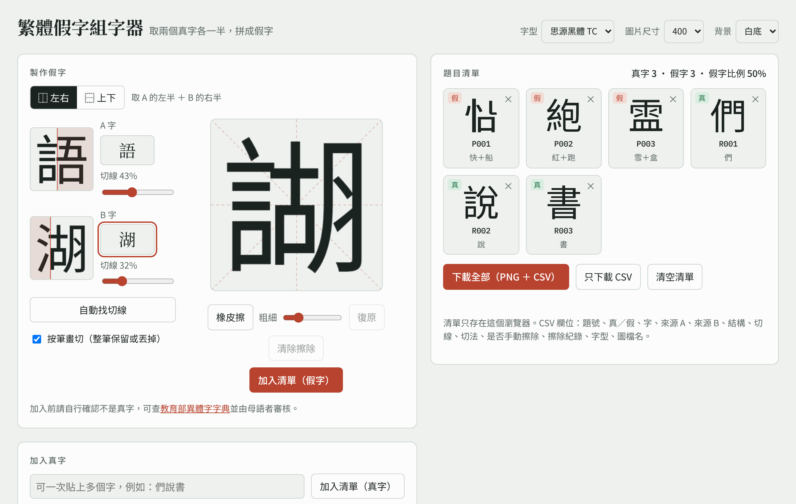

# Pseudo-character Maker

A small browser tool the team uses to build Traditional Chinese pseudo-characters (假字) for the lexical decision items, and to render real and pseudo-characters as matching images.

This is an internal working tool, shared here so others can see how the stimuli were made. It is not a polished public application.

## Method

A pseudo-character is built by joining half of one real character with half of another:

1. Choose a structure: left-right (⿰) or top-bottom (⿱).
2. Enter two real characters, A and B.
3. The tool renders both in the same font and splits each one at a cut position. For left-right, it keeps the left part of A and the right part of B; for top-bottom, the top of A and the bottom of B.
4. By default the cut is placed automatically at the column (or row) with the least ink between 28% and 72% of the glyph width. A slider adjusts each cut by hand.
5. Stroke cutting (on by default): the glyph is split into connected groups of ink. A group with at least 80% of its pixels on the kept side is kept whole; one with at most 20% is dropped whole. Only a group that lies clearly on both sides, where the two parts' strokes touch, is cut along the straight line, and the tool shows a warning. This removes the small fragments and half-cut strokes that a straight cut leaves behind. Turning it off gives a plain straight cut.
6. The two kept parts are scaled to meet at the midpoint of the two cut positions and drawn into one glyph.
7. Eraser (optional): any remaining residue can be erased by hand on the preview. Each eraser stroke is saved with the item (brush radius and points, in 400 x 400 glyph coordinates), so the image is regenerated exactly on every export and the edit is recorded in the CSV.

Example: 語 + 湖 keeps 訁 from 語 and 胡 from 湖, giving a left-right character ⿰言胡.

Cutting real glyphs, rather than scaling whole component characters, keeps each component in its proper positional form (for example 訁 on the left, not a squeezed 言).

### Real characters use the same pipeline

Real characters are rendered with the same font, size and placement as the pseudo-characters. This keeps real and pseudo items visually identical in style, so participants cannot tell them apart by rendering differences.

### Checking that a pseudo-character does not exist

The tool does not check this automatically. Every candidate is checked by hand against the Ministry of Education [Dictionary of Chinese Character Variants](https://dict.variants.moe.edu.tw/) and reviewed by 2 to 3 native speakers, who also remove items that look too much like a real character.

## Output

The item list can be downloaded as a ZIP containing one PNG per item and an `items.csv` file:

| Column | Description |
| --- | --- |
| `item_id` | `P001`... for pseudo-characters, `R001`... for real characters |
| `lexicality` | `pseudo` or `real` |
| `char` | The real character (empty for pseudo-characters) |
| `source_a`, `source_b` | The two source characters |
| `structure` | `⿰` or `⿱` |
| `cut_a`, `cut_b` | Cut positions, as a percentage of the glyph size |
| `cut_mode` | `stroke` (stroke cutting) or `line` (straight cut) |
| `manual_edit` | `yes` if the eraser was used |
| `erase_strokes` | Eraser strokes as JSON: `[{"r": radius, "p": [[x, y], ...]}]` |
| `font` | Font used for rendering |
| `image` | PNG file name |

Image size (256, 400 or 600 px) and background (white or transparent) can be set at the top of the page.

## Running it

Open `index.html` in a recent desktop browser. No build step or server is needed. An internet connection is needed to load the fonts (Noto Sans TC / Noto Serif TC from Google Fonts) and JSZip from cdnjs.

The item list is stored in the browser's local storage only.

## Limitations

- Only left-right and top-bottom structures are supported; enclosing structures (such as 國 or 問) are not.
- When the two parts of a source character touch, stroke cutting falls back to a straight cut for that group of strokes. Use a different source character or the eraser.
- Eraser strokes are tied to the font and cut positions. Changing the font or the cuts of an erased item can make the erased areas miss.
- Fonts are loaded from Google Fonts, so rendering depends on that service. For final stimuli, the font files should be pinned locally and their license confirmed for release under CC BY.
