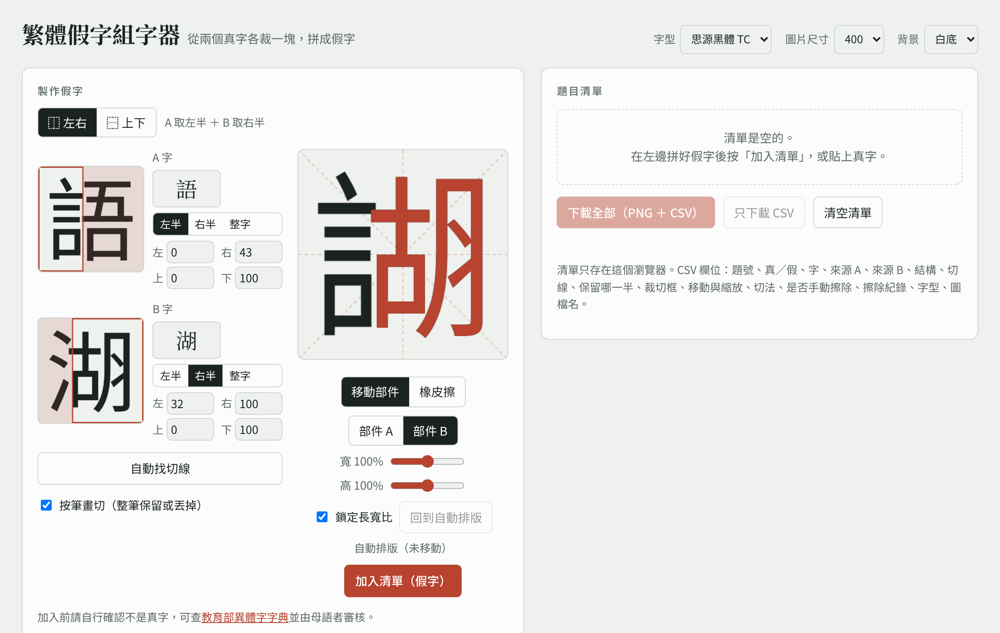

# Pseudo-character Maker

A small browser tool the team uses to build Traditional Chinese pseudo-characters (假字) for the lexical decision items, and to render real and pseudo-characters as matching images.

This is an internal working tool, shared here so others can see how the stimuli were made. It is not a polished public application.

## Method

A pseudo-character is built by cropping a part from each of two real characters and joining the parts:

1. Choose a structure: left-right (⿰) or top-bottom (⿱). The structure sets the preset crops (which half of each character is kept).
2. Enter two real characters, A and B.
3. The tool renders both in the same font. Each source has a crop box with four edges (left, top, right, bottom, as a percentage of the glyph), and only the ink inside the box is kept. The box can be set in three ways:
   - Preset buttons: first half (left or top), second half (right or bottom), or the whole character. By default A keeps its first half and B its second half. Keeping the other half moves a component to a position it does not normally take (for example 氵 on the right), which is used to make position-illegal non-characters.
   - Dragging on the source glyph: drag an edge to move it, drag inside the box to move the whole box, or drag outside the box to draw a new one. This allows cuts in both directions at once, for example only the top-left corner of a character.
   - Number fields for the four edges.
4. For a half preset, the cut is placed automatically at the column (or row) with the least ink between 28% and 72% of the glyph width. "自動找切線" re-runs this for every source whose box comes from a preset; hand-drawn boxes are left as they are.
5. Stroke cutting (on by default): the glyph is split into connected groups of ink. A group with at least 80% of its pixels inside the box is kept whole; one with at most 20% is dropped whole. Only a group that lies clearly on both sides of a box edge, where strokes touch, is cut along the edge, and the tool shows a warning. Turning it off gives a plain straight cut along the box edges.
6. Starting place: both parts start centred at their original size, exactly where they are in their source characters. They may overlap; the team sets the size and position of each part by hand.
7. Manual layout: each part keeps its own place and size. Changing a crop box only removes or adds strokes of that part; it never moves or resizes either part. Changing a source character or the structure does not move or resize either part. Nothing done to one part changes the other. "此部件置中原大小" puts the selected part back at its starting place. Either source character can be left empty, so that one part can be placed and scaled at a time without the other in the way; both characters are needed to add the item to the list.
8. Move and scale: in the "移動部件" mode, either part can be dragged on the result, nudged with the arrow keys (1 px, or 10 px with Shift, in 400 x 400 glyph coordinates), and scaled about the centre of its ink from 10% to 300% of the source character. Width and height are set separately by default ("鎖定長寬比" links them). A warning is shown when width and height differ by more than 20%, because unequal scaling changes stroke thickness and can make a pseudo-character look different from real characters. The selected part is shown in red. A warning is shown when a part touches or leaves the image edge.
9. Stroke thickness ("校正筆畫粗細"): scaling a part also scales its strokes, so a part shrunk to 70% has strokes about 70% as thick as a real character's. The button gives each part a font weight (Noto Sans TC 100 to 900, Noto Serif TC 200 to 900, in steps of 10) chosen so that the part, as it is drawn on the result (its crop, place, scale and eraser strokes), has strokes about as thick as the reference characters at weight 400. Nothing changes until the button is pressed; after a part is scaled again, the button has to be pressed again. Pressing it again without changing anything gives the same weights. The information line shows each part's weight and its measured stroke thickness compared with the reference characters, and a warning is shown when it is off by more than 15%. If a part cannot be matched within the font's weight range, the status line says so.
   - How it is measured: for every ink pixel, the shorter of its horizontal and vertical ink runs is taken (across a horizontal stroke this is the stroke's thickness), and the stroke width is the median of these values. The target is the median of this width over the reference characters (see below) at weight 400. The tool tries weights and keeps the one whose drawn part comes closest to the target. Because the part itself is measured, the source character's own stroke thickness counts: a part from a simple character such as 而, which the font draws with thicker strokes, needs less extra weight than the scale alone suggests.
   - Before 2026-11-25 the weight was estimated from the scale only (average of width and height scale, using a weight table of the reference characters measured as 2 x ink area / ink outline length). That often made parts too thick: it did not look at the part's own strokes, so a part from a character the font already draws with thick strokes (for example 而 or 心) got the same extra weight as a part from a thin-stroked one. Saved items keep their stored weights; press the button again to recalibrate an item.
   - Characters missing from the web font are drawn in a fallback font that may have no weights; for those parts the weight has little or no effect.
10. Size ("校正字的大小"): a dashed green reference frame on the result shows the median ink box of the reference characters at weight 400 (the median of their left, top, right and bottom ink edges). The button scales the whole character, both parts together and with the same width and height factor, so that its ink fits in the frame, and centres it there. Because this changes the scale, press "校正筆畫粗細" afterwards. "顯示參考框" hides or shows the frame.
   - Reference characters: the real characters in the item list when there are at least 10; otherwise the 30 common characters 的一是不了人我在有他這中大來上國個到說們為子和你地出道也時年. The frame and the target stroke width are measured in the browser, in the selected font.
11. Eraser (optional): any remaining residue can be erased by hand on the result. Each eraser stroke belongs to the part (or parts) whose ink it covers, and is stored in that source character's own pixels. Erased areas therefore move and scale with the part and stay when its crop box changes. Only "復原" (undo the last stroke) or "清除擦除" brings them back; changing a source character keeps all strokes. The strokes are saved with the item, so the image is regenerated exactly on every export and the edit is recorded in the CSV.

Example: 語 + 湖 keeps 訁 from 語 and 胡 from 湖, giving a left-right character ⿰言胡.

Cutting real glyphs, rather than scaling whole component characters, keeps each component in its proper positional form (for example 訁 on the left, not a squeezed 言).

### Real characters use the same pipeline

Real characters are rendered with the same font, size and placement as the pseudo-characters. This keeps real and pseudo items visually identical in style, so participants cannot tell them apart by rendering differences.

### Checking that a pseudo-character does not exist

The tool does not check this automatically. Every candidate is checked by hand against the Ministry of Education [Dictionary of Chinese Character Variants](https://dict.variants.moe.edu.tw/) and reviewed by 2 to 3 native speakers, who also remove items that look too much like a real character.

## Output

The item list can be downloaded as a ZIP containing one PNG per item and an `items.csv` file:

| Column | Description |
| --- | --- |
| `item_id` | `P001`... for pseudo-characters, `R001`... for real characters |
| `lexicality` | `pseudo` or `real` |
| `char` | The real character (empty for pseudo-characters) |
| `source_a`, `source_b` | The two source characters |
| `structure` | `⿰` or `⿱` |
| `cut_a`, `cut_b` | Cut positions, as a percentage of the glyph size. Empty when the crop box is not a half of the glyph |
| `keep_a`, `keep_b` | Which half of each source is kept: `left`/`right` or `top`/`bottom`. Default: `left`/`top` for A, `right`/`bottom` for B. Empty when the crop box is not a half of the glyph |
| `crop_a`, `crop_b` | Crop box as JSON `[left, top, right, bottom]`, percentages of the glyph size. Always filled; for a half it repeats `cut_*` and `keep_*` |
| `move_a`, `move_b` | Automatic-layout items only (made before 2026-11-17): move and scale of each part as JSON `[dx, dy, sx, sy]` on top of the automatic layout: offset in pixels of the 400 x 400 glyph, then width and height scale (1 = unchanged). `[0,0,1,1]` means the automatic layout. Empty for manual-layout items |
| `cut_mode` | `stroke` (stroke cutting) or `line` (straight cut) |
| `manual_edit` | `yes` if the eraser was used |
| `erase_strokes` | Automatic-layout items only: eraser strokes on the result as JSON `[{"r": radius, "p": [[x, y], ...]}]` |
| `font` | Font used for rendering |
| `image` | PNG file name |
| `layout` | `manual` (items made from 2026-11-17) or `auto` (older items, rendered exactly as before) |
| `place_a`, `place_b` | Manual layout: place of each part as JSON `[dx, dy, sx, sy]`. A source pixel at `x` is drawn at `(x - 200) * sx + 200 + dx` (same for `y` with `sy`, `dy`), in 400 x 400 glyph pixels; `[0,0,1,1]` draws the source character where it is |
| `erase_a`, `erase_b` | Manual layout: eraser strokes of each part as JSON `[{"r": radius, "s": [sx, sy], "p": [[x, y], ...]}]`. Points are in the source character's pixels, `r` is the brush radius on the result when drawn, and `s` is the part's scale when drawn |
| `weight_a`, `weight_b` | Manual layout: font weight of each part (400 = regular; other values come from "校正筆畫粗細") |

Image size (256, 400 or 600 px) and background (white or transparent) can be set at the top of the page.

## Running it

Open `index.html` in a recent desktop browser. No build step or server is needed. An internet connection is needed to load the fonts (Noto Sans TC / Noto Serif TC from Google Fonts) and JSZip from cdnjs.

The item list is stored in the browser's local storage only. Items made with earlier versions of the tool (a cut and a kept half, no crop box) are still read and render exactly as before.

## Limitations

- Only two source characters per item. Any arrangement, including enclosing structures (such as 國 or 問), is built by moving and scaling the parts by hand.
- Parts are not fitted together automatically. Each item needs its parts placed and scaled by hand.
- Older items (made before 2026-11-17) used an automatic layout that scaled the parts along the structure's axis to fit side by side. They are kept and rendered as they were.
- When the two parts of a source character touch, stroke cutting falls back to a straight cut for that group of strokes. Use a different source character or the eraser.
- Eraser strokes are tied to the font. Changing the font of an erased item can make the erased areas miss.
- Opening an older (automatic-layout) item in the editor turns it into a manual-layout item with the same picture; adding it to the list again saves it as a new manual-layout item. The original item in the list is not changed.
- Fonts are loaded from Google Fonts, so rendering depends on that service. For final stimuli, the font files should be pinned locally and their license confirmed for release under CC BY.
